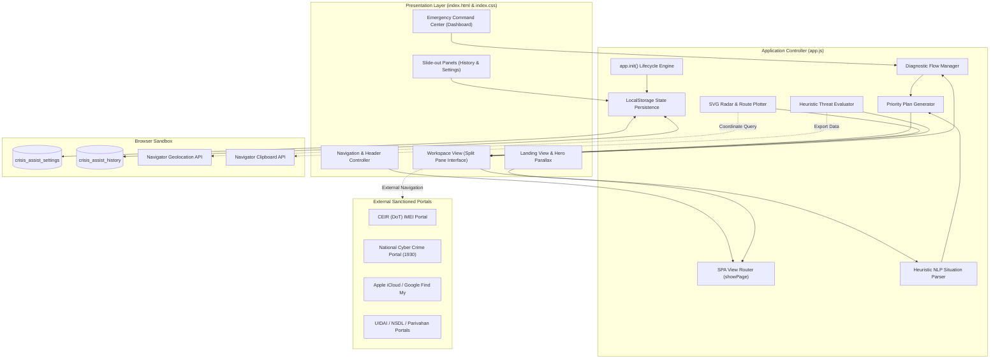
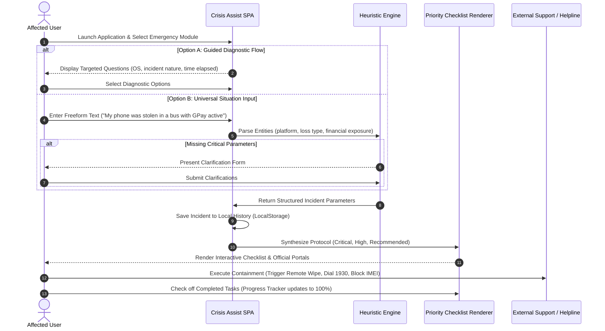

# Crisis Assist 🛡️

> **When emergencies happen, clarity matters.**  
> An AI-powered, privacy-first emergency recovery platform engineered to transform panic into decisive action through structured checklists, scam verification, and rapid incident response protocols.

---

[](https://opensource.org/licenses/MIT)
[](https://developer.mozilla.org/en-US/docs/Web/JavaScript)
[](https://developer.mozilla.org/en-US/docs/Web/CSS)
[](https://developer.mozilla.org/en-US/docs/Web/HTML)
[](https://lucide.dev/)
[](https://developer.mozilla.org/en-US/docs/Web/API/Window/localStorage)

---

## 📌 Table of Contents

- [Overview](#-overview)
- [Key Features](#-key-features)
- [Application Modules](#-application-modules)
- [Visual Showcase & Screenshots](#-visual-showcase--screenshots)
- [System Architecture](#-system-architecture)
- [Project Workflow](#-project-workflow)
- [Technology Stack](#-technology-stack)
- [Project Structure](#-project-structure)
- [Installation & Setup](#-installation--setup)
- [Usage Guide](#-usage-guide)
- [Configuration & Settings](#-configuration--settings)
- [Security & Privacy Model](#-security--privacy-model)
- [Roadmap & Future Enhancements](#-roadmap--future-enhancements)
- [Contributing](#-contributing)
- [License](#-license)
- [Author & Acknowledgements](#-author--acknowledgements)

---

## 🌟 Overview

During high-stress emergencies—such as losing a phone loaded with banking apps, falling prey to an online financial scam, misplacing identity documents, or being stranded in an unfamiliar transit hub—individuals face severe cognitive overload. Panic often leads to delayed containment, enabling threat actors to exploit credentials, drain accounts, or hijack identities.

**Crisis Assist** is a zero-latency, client-side emergency response command center designed to eliminate indecision. It guides affected individuals through priority-ranked recovery workflows, segregating critical containment steps from secondary administrative procedures. Operating entirely within local browser memory, Crisis Assist requires zero registration, generates actionable checklists in seconds, and guarantees complete confidentiality.

### 🎯 Value Proposition

- **Triage Under Pressure:** Replaces chaotic web searches with an immediate, priority-weighted sequence (Critical 🔴, High 🟠, Recommended 🟡).
- **Golden-Hour Intervention:** Tailors cyber fraud protocols around the critical two-hour window for freezing transactions before funds exit interbank clearing.
- **Privacy by Design:** Zero tracking cookies, zero external database transmissions, and zero risk of credential interception.
- **Universal Diagnostic Input:** Accepts either guided multi-step selectors or freeform plain-text incident descriptions parsed via an integrated heuristic router.

---

## ✨ Key Features

- 📱 **Lost Phone Containment Matrix:** Customized recovery paths for iOS and Android environments, integrating Apple Find My, Google Find My Device, carrier SIM suspension procedures, and CEIR global IMEI blacklisting.
- 💳 **Cyber Fraud Rapid Lock:** Incident containment covering UPI fraud, unauthorized card debits, OTP phishing, and malicious investment schemes, backed by the 1930 National Cyber Crime reporting protocol.
- 👛 **Targeted Wallet Replacement:** Multi-document selector generating tailored reissuance pathways for debit/credit cards, Aadhaar (UIDAI), PAN (NSDL/UTIITSL), Driving Licenses (Parivahan), passports, and workplace credentials.
- 🧭 **Emergency Transit Radar Map:** Interactive SVG-based radar display featuring GPS coordinates, real-time node filtering (Hotels, Hospitals, Police, Fuel), direct line-of-sight route plotting, and quick-call transit services.
- 🔍 **AI Scam & Threat Analyzer:** Unified inspection workspace evaluating suspicious links (domain spoofs, non-standard TLDs), urgent SMS/WhatsApp baits, screenshot OCR evidence, and deepfake media indicators with exportable audit logs.
- 🤖 **Interactive AI Assistant:** Dual-pane conversational console that dynamically synthesizes plain-text queries into live step-by-step containment checklists, customizable across four conversational styles and response lengths.
- ⚙️ **Comprehensive Preference Engine:** Dark/Light/System theme toggles, 4 vibrant neon accent color palettes (Orange Glow, Emerald Green, Purple Storm, Cyan Ice), compact view modes, multilingual dropdowns, and SOS emergency contact storage.
- 📜 **Incident History & Vault:** Ephemeral local timeline allowing users to revisit past diagnostic sessions, inspect checklists, remove single entries, or flush storage.

---

## 🧩 Application Modules

| Module | Core Purpose | Diagnostic Inputs | Primary Outputs & Integrations |
| :--- | :--- | :--- | :--- |
| **Lost Phone Recovery** | Neutralize device access and prevent OTP interception | OS (iOS/Android), nature (lost/stolen), elapsed time, SIM state, banking presence | iCloud Find, Google Find My, remote wipe triggers, CEIR IMEI blocking, SIM lock guidance |
| **Cyber Fraud Assistant** | Stop illicit transfers and freeze destination accounts | Fraud type (UPI/Card/OTP/Phishing), time elapsed, amount severity, bank contact status | 1930 Cyber helpline routing, interbank freeze steps, evidence archiving guidelines |
| **Lost Wallet Recovery** | Replace lost payment cards and government identity cards | Multi-select list (Debit, Credit, Aadhaar, PAN, DL, Office ID, Passport, Cash) | UIDAI PVC reprint, NSDL PAN reorder, Parivahan portal, bank card hotlisting links |
| **Travel Emergency Help** | Re-route stranded travelers and locate critical facilities | Transit type (Flight, Train, Bus, Cab, Baggage, Stranded), immediate requirement | Dynamic SVG radar scanner, POI waypoint mapping, IRCTC Tatkal, airline cargo hold |
| **AI Scam Analyzer** | Assess risk of fraudulent URLs, messages, and media | URL text, raw SMS string, uploaded screenshot/video file | Risk score badge (High/Med/Low), threat signals breakdown, exportable text report |
| **Conversational AI** | Natural language guidance for complex emergency scenarios | Freeform chat prompt, situational descriptions | Structured dual-pane checklist, copyable FIR / bank dispute letter templates |

---

## 📸 Visual Showcase & Screenshots

The application leverages a responsive, obsidian-glassmorphism aesthetic built on an atomic color design system. Visual preview assets are located in `anti gravity 1 seperate/assets/`:

| Module / View | Visual Preview Asset | Description |
| :--- | :--- | :--- |
| **Emergency Landing Hero** | `anti gravity 1 seperate/assets/panic_lady.jpg` | Parallax hero section with dynamic glass cards and particle animations |
| **Lost Phone Recovery** | `anti gravity 1 seperate/assets/lost_phone.jpg` | Device ecosystem containment and SIM suspension workflows |
| **Cyber Fraud Assistant** | `anti gravity 1 seperate/assets/cyber_fraud.jpg` | Banking alert lock sequences and 1930 emergency integration |
| **Lost Wallet Recovery** | `anti gravity 1 seperate/assets/lost_wallet.png` | Multi-card and government ID document replacement engine |
| **Travel Emergency Radar** | `anti gravity 1 seperate/assets/travel_emergency.jpg` | SVG radar visualization, transit re-booking, and POI navigation |
| **AI Scam Analyzer** | `anti gravity 1 seperate/assets/scam_analyzer.jpg` | Heuristic threat detector for URLs, SMS messages, and synthetic media |
| **AI Conversational Assistant** | `anti gravity 1 seperate/assets/ai_assistant.png` | Dual-pane natural language assistant with dynamic checklist rendering |

> **Note:** To preview or update screenshots in your documentation, place captured images in the `assets/` directory and reference them using relative paths.

---

## 🏗️ System Architecture

Crisis Assist is designed as an ultra-lightweight, zero-dependency Single Page Application (SPA). It maintains complete state management on the client side, allowing instantaneous rendering without round-trip network delays.



---

## 🔄 Project Workflow



---

## 💻 Technology Stack

| Category | Technology | Purpose & Implementation Details |
| :--- | :--- | :--- |
| **Core Architecture** | Pure Vanilla JavaScript (ES6+) | Object-oriented modular controller (`app.js`), dynamic DOM injection, zero external build toolchain |
| **Markup & Semantic Structure** | HTML5 (SPA Architecture) | Modular single-page layout (`index.html`) featuring accessible sections, views, modals, and forms |
| **Styling & Design System** | Modern CSS3 Custom Properties | Obsidian Nights theme (`index.css`), CSS Glassmorphism (`backdrop-filter`), CSS Grid, and responsive flex layouts |
| **Iconography** | Lucide Icons (CDN) | Modern vector icon set dynamically instantiated across UI elements |
| **Visual Computing** | SVG Vector Engine | Procedural radar sweep animations, concentric circles, POI coordinates, and dynamic path routing |
| **Client Storage** | HTML5 Web Storage API | `localStorage` for offline persistence of application settings, theme configurations, and incident history |
| **Hardware APIs** | Browser Web APIs | Geolocation API (`navigator.geolocation`) for coordinates lock; Clipboard API (`navigator.clipboard`) for report exports |

---

## 📁 Project Structure

```plaintext
crisis/
│
└── crisis-assist/
    ├── .git/                                 # Git version control metadata
    │
    ├── anti gravity 1 seperate/               # Core application source directory
    │   ├── assets/                           # High-resolution visual media assets
    │   │   ├── ai_assistant.png              # Conversational assistant preview artwork
    │   │   ├── cyber_fraud.jpg               # Cyber scam incident graphic
    │   │   ├── lost_phone.jpg                # Lost phone diagnostic illustration
    │   │   ├── lost_wallet.png               # Document and card replacement visual
    │   │   ├── panic_lady.jpg                # Parallax hero background graphic
    │   │   ├── scam_analyzer.jpg             # Threat analysis workspace illustration
    │   │   └── travel_emergency.jpg          # Transit disruption and radar visual
    │   │
    │   ├── app.js                            # Unified client-side controller & state engine (133 KB)
    │   ├── index.css                         # Obsidian Glassmorphic design system (63 KB)
    │   └── index.html                        # Application markup, views, and navigation (45 KB)
    │
    └── README.md                             # Comprehensive project documentation
```

### Detailed File Overview

- **`anti gravity 1 seperate/index.html`**: Contains the semantic structure for all three primary application states (Landing Page, Central Emergency Dashboard, and the Split-Pane Module Workspace), alongside the slide-out drawers for settings and history.
- **`anti gravity 1 seperate/index.css`**: Defines CSS tokens (`--accent-orange`, `--accent-green`, `--accent-purple`), responsive layout media queries, particle animations, glassmorphism cards, and customized scrollbar components.
- **`anti gravity 1 seperate/app.js`**: Houses the global `app` controller object encompassing SPA navigation, event delegation, dynamic question rendering, heuristic keyword analysis, SVG radar calculations, and local storage serialization.

---

## 🚀 Installation & Setup

Crisis Assist is completely standalone and client-side. It requires no backend server, database, or package build step.

### Prerequisites

- Any modern web browser supporting ES6+ JavaScript and CSS Glassmorphism:
  - Google Chrome 90+
  - Mozilla Firefox 88+
  - Microsoft Edge 90+
  - Apple Safari 14+

### Clone the Repository

```bash
git clone https://github.com/ronakagrawal0404/crisis-assist.git
cd crisis-assist
```

### Running Locally

Choose any of the following methods to launch the application:

#### Method 1: Direct Browser Launch (Fastest)
Navigate into the application folder and open `index.html` directly in your browser:
- On Windows: Double-click `anti gravity 1 seperate/index.html` or run:
  ```powershell
  Start-Process ".\anti gravity 1 seperate\index.html"
  ```
- On macOS:
  ```bash
  open "anti gravity 1 seperate/index.html"
  ```
- On Linux:
  ```bash
  xdg-open "anti gravity 1 seperate/index.html"
  ```

#### Method 2: Node.js Static Server
If you have Node.js installed, you can spin up a local static server:
```bash
# Using npx serve
npx serve "anti gravity 1 seperate"

# Alternatively, using http-server
npx http-server "anti gravity 1 seperate" -p 3000
```
Then navigate to `http://localhost:3000` in your browser.

#### Method 3: Python Built-in HTTP Server
```bash
# Navigate to the application source folder
cd "anti gravity 1 seperate"

# Launch Python HTTP server
python -m http.server 8080
```
Open your browser and visit `http://localhost:8080`.

#### Method 4: VS Code Live Server
1. Open the project folder in Visual Studio Code.
2. Install the **Live Server** extension (`ritwickdey.LiveServer`).
3. Right-click `index.html` in the explorer and select **"Open with Live Server"**.

---

## 📖 Usage Guide

### 1. Recovering a Lost or Stolen Mobile Device
1. Open the **Emergency Command Center** and select **Lost Phone Recovery**.
2. Answer the diagnostic prompts regarding your operating system (Apple iOS vs. Android), whether the device was misplaced or stolen, time elapsed, active SIM status, and presence of financial apps.
3. *Alternative:* Use the **Universal Situation Input** panel to type: *"My iPhone was stolen in the subway with Google Pay and UPI active"*.
4. Review the generated priority checklist:
   - Click the provided links to open **iCloud Find** or **Google Find My Device** to lock or sound the device.
   - Use the **Contain Device** button if recovery fails to trigger full remote data wipe and register an IMEI block on the national CEIR portal.

### 2. Immediate Response to Cyber Fraud
1. Click **Cyber Fraud Assistant** on the Dashboard.
2. Specify the incident type (UPI transfer, card fraud, OTP phishing, or fake investment).
3. Identify whether you are within the **Golden Window** (under 2 hours since transaction).
4. Follow the prioritized containment steps:
   - Immediately dial **1930** or access the National Cyber Crime Reporting Portal.
   - Execute the emergency debit/credit card blocking links.
   - Document transaction reference numbers, debit SMS alerts, and beneficiary accounts.

### 3. Recovering a Lost Wallet
1. Open **Lost Wallet Recovery**.
2. Click to toggle all documents and cards that were in your wallet (e.g., Debit Card, Aadhaar, PAN Card, Driving License).
3. Click **Generate Plan** to receive direct, authoritative portals for:
   - Hotlisting bank cards through dedicated banking lines.
   - Ordering duplicate Aadhaar PVC cards via the UIDAI portal.
   - Requesting PAN reprint via NSDL.
   - Filing for duplicate Driving Licenses on the Parivahan Sarathi platform.

### 4. Navigating Travel Emergencies
1. Open **Travel Emergency Help** and select your disruption (Missed Train, Missed Flight, Stranded).
2. The interactive **Radar Map** locks to your coordinates and displays nearby Points of Interest:
   - Filter by **Hotels**, **Hospitals**, **Police Substations**, or **Fuel Stations**.
   - Click any node on the map to display its distance and status.
   - Click **Plot Route** to draw a line-of-sight vector from your location to the facility.
   - Access rapid-dispatch micro-transit buttons for Uber, Rapido, and local emergency helplines.

### 5. Scanning Suspicious Links, Messages, and Media
1. Access the **AI Scam & Content Analyzer**.
2. Select your desired inspection mode:
   - **Link / URL:** Paste suspicious links to test against impersonation heuristics and non-standard domain extensions.
   - **Message Text:** Paste urgent SMS or WhatsApp messages to evaluate urgency patterns and credential harvesting phrases.
   - **Image / Screenshot:** Drag and drop payment confirmation or bank warning screenshots.
   - **Deepfake Scan:** Upload video or audio clips to evaluate synthetic media anomalies.
3. Review the **Unified Security Report**, copy findings to your clipboard, or export them as a `.txt` audit file.

### 6. Conversing with the AI Assistant
1. Click **AI Assistant** in the main header navigation or select it from the Dashboard.
2. Type any emergency inquiry (e.g., *"Draft an FIR report for my lost passport"* or *"Someone is demanding money claiming my SIM will be blocked"*).
3. The left pane provides instant advice and copyable document templates, while the right pane simultaneously constructs a live, interactive recovery checklist.

---

## ⚙️ Configuration & Settings

All application settings are managed via the slide-out **Settings Panel** (accessible via the gear icon in the top header) and saved to browser `localStorage`:

```json
{
  "theme": "dark",
  "accent": "orange",
  "compactMode": false,
  "language": "en",
  "dateFormat": "local",
  "aiStyle": "balanced",
  "aiLength": "medium",
  "aiFollowups": true,
  "aiPrompts": true,
  "privacyStore": true,
  "privacyDuration": "never",
  "locationGPS": false,
  "locationManual": "New Delhi, India",
  "locationRecs": true,
  "contacts": [
    {
      "name": "Emergency Contact",
      "phone": "+91 99999-00000",
      "relationship": "Family"
    }
  ]
}
```

### Configuration Options

- **Appearance:** Toggle between **Dark**, **Light**, or **System** themes, and select one of 4 neon accent colors: `orange`, `green`, `purple`, or `cyan`.
- **Display Modes:** Enable **Compact Mode** for high-density information displays.
- **Language & Localization:** Select interface language (English, Spanish, French, Hindi) and date-time format.
- **AI Tone Controls:** Select conversational style (`balanced`, `professional`, `friendly`, `concise`) and detail depth (`short`, `medium`, `detailed`).
- **Emergency Directory:** Add custom contacts with names, telephone numbers, and relationships for instant access during critical situations.
- **Privacy Lifecycle:** Enable or disable local history persistence and configure automated history purge periods (1 day, 7 days, 30 days, or never).

---

## 🔒 Security & Privacy Model

In an emergency, users must not be forced to trust unknown servers with sensitive incident data. Crisis Assist adheres to strict client-side security principles:

- **100% Client-Side Execution:** No user input, incident narrative, phone number, or diagnostic choice is ever transmitted to an external application server.
- **Sandboxed Heuristics:** Scam detection and text parsing are evaluated locally inside the browser's JavaScript V8 engine using heuristic string matching and regex rules.
- **Zero Credential Collection:** The platform never requests full credit card numbers, CVVs, netbanking passwords, or OTP values. Tasks instruct users how to safely navigate to official banking websites independently.
- **Authoritative Link Grounding:** All external recovery links connect exclusively to official government and enterprise portals (e.g., `cybercrime.gov.in`, `ceir.gov.in`, `icloud.com`, `google.com/android/find`).
- **Local Data Sovereignity:** All session logs and emergency contacts reside within the browser's origin-isolated `localStorage` and can be purged permanently with one click.

---

## 🔮 Roadmap & Future Enhancements

The following capabilities are planned for upcoming iterations of the project:

- [ ] **Offline Progressive Web App (PWA):** Service worker integration for 100% offline checklist access during catastrophic network outages.
- [ ] **Client-Side WebAssembly OCR:** In-browser Tesseract.js integration for real-time offline optical character recognition on uploaded screenshots.
- [ ] **Official Threat Intelligence Feeds:** Optional opt-in synchronization with public phishing blocklists (e.g., PhishTank, OpenPhish API).
- [ ] **Multi-Region Emergency Directories:** Automatic localization of emergency response telephone numbers (police, fire, ambulance, consular) based on geocoded IP or GPS coordinates.
- [ ] **Encrypted Vault Export:** Password-protected AES-256 export and import of saved emergency contacts and recovery reports.

---

## 🤝 Contributing

Contributions are welcomed from developers, cybersecurity advocates, and technical writers!

### How to Contribute

1. **Fork the Repository:**
   Click the **Fork** button at the top right of the GitHub repository page.

2. **Clone your Fork:**
   ```bash
   git clone https://github.com/<your-username>/crisis-assist.git
   cd crisis-assist
   ```

3. **Create a Feature Branch:**
   ```bash
   git checkout -b feature/enhanced-analyzer
   ```

4. **Implement your Changes:**
   - Adhere to the established vanilla JavaScript coding patterns in `app.js`.
   - Maintain the obsidian glassmorphism design tokens in `index.css`.
   - Ensure complete responsiveness across mobile and desktop breakpoints.

5. **Commit your Changes:**
   ```bash
   git commit -m "feat: add additional fraud heuristics for banking impersonation"
   ```

6. **Push and Open a Pull Request:**
   ```bash
   git push origin feature/enhanced-analyzer
   ```
   Open a Pull Request describing your changes and testing steps.

---

## 📄 License

This project is licensed under the **MIT License**.

```plaintext
MIT License

Copyright (c) 2026 Crisis Assist Platform

Permission is hereby granted, free of charge, to any person obtaining a copy
of this software and associated documentation files (the "Software"), to deal
in the Software without restriction, including without limitation the rights
to use, copy, modify, merge, publish, distribute, sublicense, and/or sell
copies of the Software, and to permit persons to whom the Software is
furnished to do so, subject to the following conditions:

The above copyright notice and this permission notice shall be included in all
copies or substantial portions of the Software.

THE SOFTWARE IS PROVIDED "AS IS", WITHOUT WARRANTY OF ANY KIND, EXPRESS OR
IMPLIED, INCLUDING BUT NOT LIMITED TO THE WARRANTIES OF MERCHANTABILITY,
FITNESS FOR A PARTICULAR PURPOSE AND NONINFRINGEMENT. IN NO EVENT SHALL THE
AUTHORS OR COPYRIGHT HOLDERS BE LIABLE FOR ANY CLAIM, DAMAGES OR OTHER
LIABILITY, WHETHER IN AN ACTION OF CONTRACT, TORT OR OTHERWISE, ARISING FROM,
OUT OF OR IN CONNECTION WITH THE SOFTWARE OR THE USE OR OTHER DEALINGS IN THE
SOFTWARE.
```

---

## 👤 Author & Acknowledgements

- **Repository:** [ronakagrawal0404/crisis-assist](https://github.com/ronakagrawal0404/crisis-assist)
- **Design Inspiration:** Modern obsidian cyber-command interfaces & glassmorphism UX principles.
- **Icons:** [Lucide Icons](https://lucide.dev/)
- **Emergency Portals Referenced:**
  - National Cyber Crime Reporting Portal (Govt. of India) - [cybercrime.gov.in](https://cybercrime.gov.in/)
  - Central Equipment Identity Register (CEIR) - [ceir.gov.in](https://www.ceir.gov.in/)
  - UIDAI Self Service Update Portal - [uidai.gov.in](https://myaadhaar.uidai.gov.in/)
  - Parivahan Sarathi Transport Portal - [sarathi.parivahan.gov.in](https://sarathi.parivahan.gov.in/)

---

<div align="center">
  <sub>Crisis Assist – Engineered for high-stress scenarios where quick decisions make all the difference.</sub>
</div>
